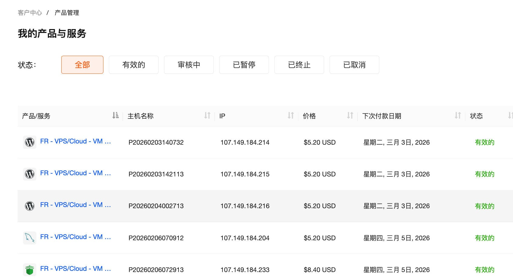
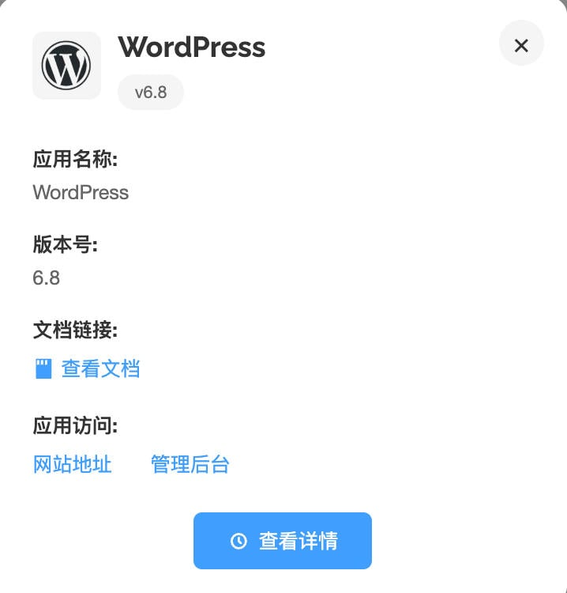
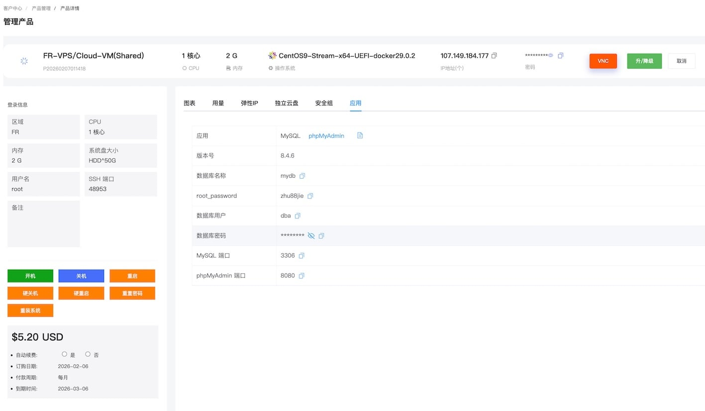

### 查看已购应用

应用购买完成后，您可以在“客户中心 → 产品管理 → 我的产品与服务”页面查看，查看方式与原有的 VPS/裸机云产品相同。



在产品列表中，应用会在名称前显示对应的图标，方便您快速识别。将鼠标悬浮在产品名称上，可以看到应用的基本信息，包括应用名称、版本号及访问地址等。



### 应用详情页

点击产品名称进入详情页，页面布局与原有的 VPS/裸机云产品管理页面相同。

针对应用，我们在右侧管理面板中新增了“应用”标签页。点击该标签，您可以查看：

- 应用名称和版本号
- 访问地址等信息
- 应用的参数配置详情
- 应用文档链接（点击可查看完整的应用使用文档）



> **注意**
>
> 首次创建或者重装应用后，应用需要约 1~3 分钟完成加载。建议在操作后稍作等待再访问应用，避免因服务未就绪而导致访问失败。

### 访问凭证说明

所有应用涉及的访问信息（如数据库密码、管理员账号等）均存放于服务器的凭证文件中：

- 文件路径：`/opt/cloud/<应用名称>/credentials.txt`
- 示例：WordPress 应用的凭证文件为 `/opt/cloud/wordpress/credentials.txt`

您可以通过 SSH 登录服务器后查看该文件，获取完整的访问信息：

```bash
cat /opt/cloud/<应用名称>/credentials.txt
```

### 运维操作

应用本质上运行在 VPS 或裸机云服务器上，您可以像管理普通云服务器一样进行运维操作，如开机、关机、重启等。

如需了解应用相关的运维命令（如启动、停止、备份等），可以通过 SSH 登录服务器查看。登录后的欢迎信息中会显示该应用的常用管理命令，您也可以参考各应用的使用指南获取更多信息。
