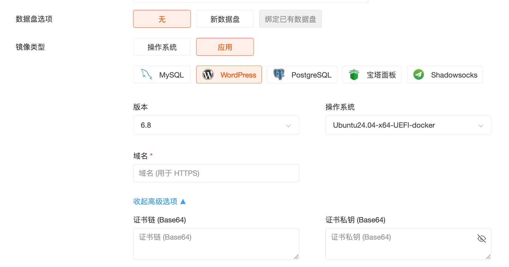

除了从应用落地页快速部署外，您也可以从 VPS 或裸机云的产品购买页面进入，选择应用镜像进行部署。

这种方式适合希望自定义更多服务器配置的用户。在价格计算器页面中，您可以详细配置 CPU、内存、硬盘、网络等参数。由于每款应用有最低配置要求，页面中展示的配置选项均已满足该应用的运行需求。

在“操作系统”选项中，将标签页切换到“应用市场”，即可看到所有可用的应用。选择应用后，您还可以进一步选择应用的版本以及对应的操作系统。

