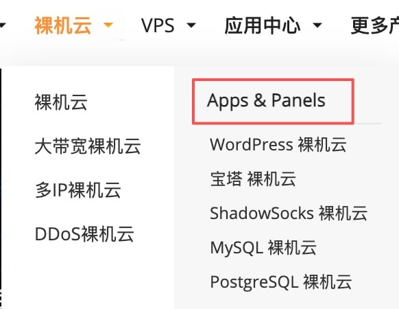
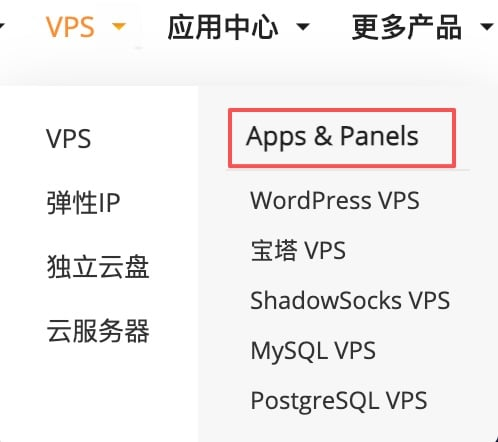
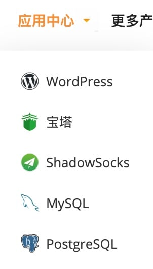
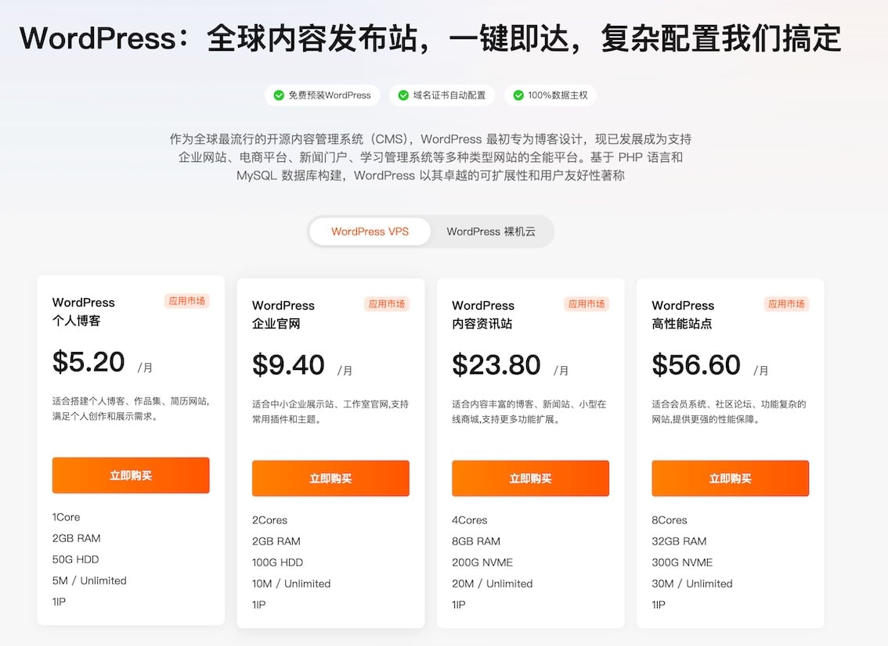
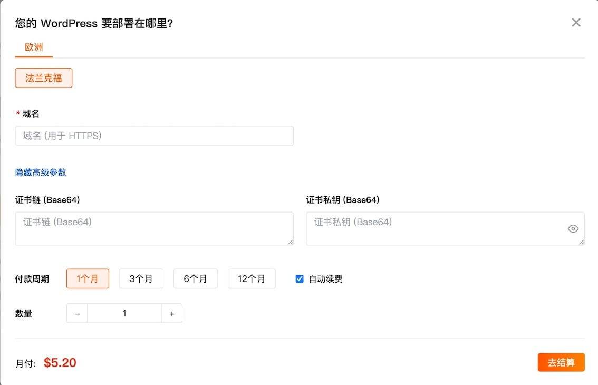
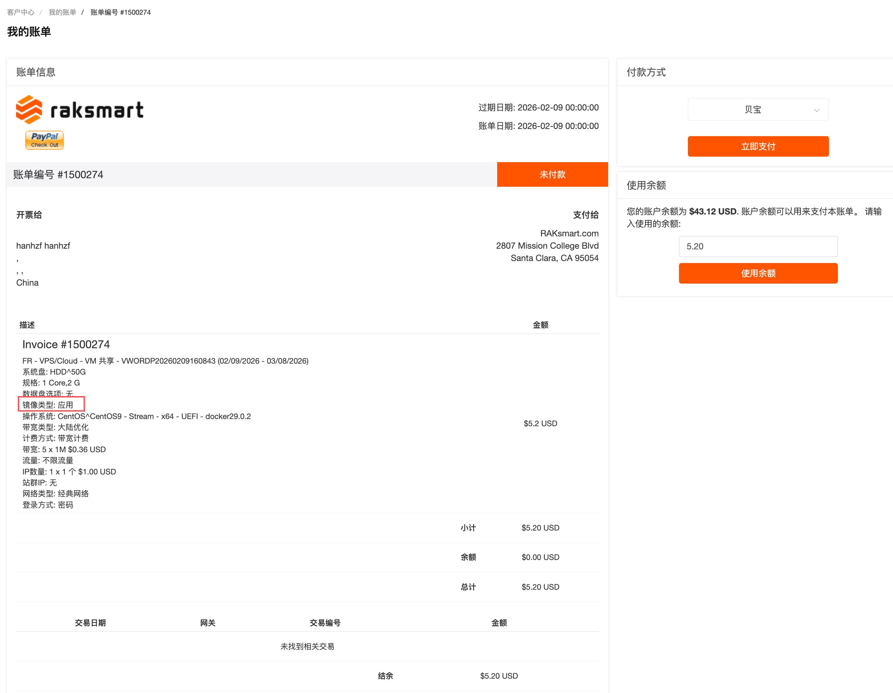

### 应用市场入口位置

应用中心已在裸机云和 VPS 产品上线。您可以通过以下方式进入：

**方式一：从云产品菜单进入**

如果您已确定使用裸机云或 VPS，可以在网站顶部导航栏点击对应菜单，在下拉列表中找到“APPS”分类，选择需要的应用。

**方式二：从应用中心进入**

如果您想先浏览有哪些应用可选，可以点击导航栏的“应用中心”，查看全部应用列表。

### 应用选购流程

1. **选择应用和配置**

   进入应用落地页后，您可以看到应用的基本介绍。页面上提供了针对不同使用场景的配置套餐推荐，您也可以在 VPS 和裸机云之间切换选择。确定配置后，点击“立即购买”。

   

2. **填写部署信息**

   在弹出的购买窗口中，完成以下配置：

   - **部署区域**：选择服务器所在的地理位置（美洲、亚洲、欧洲）。
   - **主机名和主机密码**：设置服务器的登录凭据，部署完成后可通过 SSH 登录服务器进行管理。
   - **应用参数**：根据应用要求填写必要的配置参数（如数据库密码、域名等）。
   - **付款周期和数量**：选择购买时长和数量。

   填写完成后，点击“去结算”。

   

3. **确认订单并完成支付**

   在订单确认页核对信息，如有优惠券可在此使用，确认无误后完成支付。支付完成后进入账单页面，您可以在此查看本次购买的完整信息，包括服务器的详细配置参数。

   完成支付后，系统将自动开始部署应用，整个过程预计在 1-3 分钟内完成。

   

> **提示**
>
> 虚拟机启动后，应用需要约 1~3 分钟的初始化时间。请在部署完成后稍作等待，待应用完全加载后再进行访问，以确保获得最佳使用体验。
