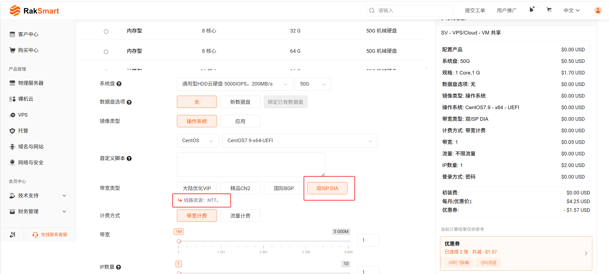

1. 登录 [RakSmart 官网](https://cn.raksmart.com/)，通过以下任一入口进入购买页面：
    
    - **物理服务器** 或 **裸机云** 菜单下的双ISP DIA 推荐配置页，选择推荐配置并下单。
	    - [双ISP DIA（家庭IP）物理服务器](https://cn.raksmart.com/dedicated-isp)
	    - [双ISP DIA（家庭IP）裸机云](https://cn.raksmart.com/bare-isp)
    - 常规产品下单页。
    
    
2. 选择所需的**地区**。
    
3. 在**带宽类型**中选择 **双ISP DIA**，页面会提示该线路的线路资源。
    
4. 选择带宽、服务器配置，并选择 IP：
    
    - VPS、裸机云：选择**普通 IP** 数量，或选择 **站群 IP**。
    - 物理服务器：选择 **IP 地址** 数量，或选择**更多 IPv4**。
5. 确认配置与价格，单击**立即购买**生成账单并完成付款。
    
    > **说明**
    > 
    > 下单、优惠券使用和付款流程，请参考新手指南中的[购买 RakSmart 产品](/beginners-guide/buy-products/purchase.md)。费用可在价格计算器的订购总额中查看。
    
