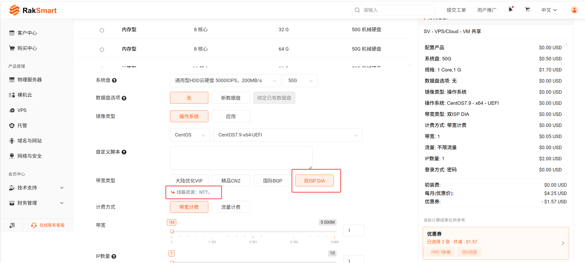
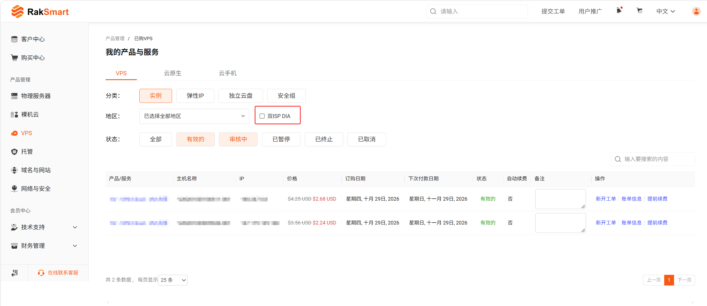

# 双ISP DIA（家庭IP）产品介绍

本文主要介绍 RakSmart 双ISP DIA（家庭IP）产品的概念、优势、适用场景、产品规格、购买方式以及 IP 属性验证方法。

> **说明**
> 
> 在使用 TikTok、YouTube、Netflix 等社交媒体、视频及流媒体服务，以及跨境电商、AI 等在线服务时，相关服务提供方可能会根据自身规则，综合 IP 属性、账号状态及实际使用行为进行识别和风险控制。因此，RakSmart 无法保证双 ISP DIA IP 在所有服务及使用场景下均不受限制。

## 什么是双ISP DIA

双ISP DIA（英文：Dual ISP DIA）是 RakSmart 提供的一种带宽线路类型，采用具有 ISP（Internet Service Provider，互联网服务提供商）分类属性的 IP 资源。

**双 ISP IP** 是市场上对一种 IP 网络身份分类特征的描述，通常指一个 IP 地址关联的公司类型（Company Type）与所属自治系统类型（ASN Type）均被识别为 ISP。

其中：

- **Company Type = ISP：** IP 关联的公司被识别为互联网服务提供商。
    
- **ASN Type = ISP：** IP 关联的自治系统所属组织被识别为互联网服务提供商。
    

需要注意，双 ISP 是一种市场上的 IP 属性描述，并非统一的行业认证标准。不同 IP 数据库可能采用不同的识别规则，因此具体分类结果可能存在差异。

---

### 名称含义

|名称|含义|
|---|---|
|ISP|Internet Service Provider，互联网服务提供商（运营商）。|
|双 ISP|IP 的 **ASN 类型**（自治系统类型）与 **公司类型** 两项均为 ISP。|

---

### IP 属性为什么重要

每个公网 IP 都会登记在公开的 IP 数据库中，包含所属网络、所属公司、网络类型等信息，就像 IP 的"身份信息"。海外平台判断访问来源时，会参考这些信息：

- **普通机房 IP**：通常登记为数据中心（Hosting / IDC），部分平台会对这类 IP 加强验证或限制访问。
- **双 ISP IP**：登记信息为运营商（ISP），网络属性更接近普通用户上网使用的 IP，有助于减少因 IP 身份引起的频繁验证和访问受限。

---

### IP 身份示例

| 字段                 | 示例              |
| ------------------ | --------------- |
| IP                 | xxx.xxx.xxx.xxx |
| ASN                | AS 编号 · 运营商名称   |
| ASN Type（自治系统类型）     | ISP             |
| Company Type（公司类型） | ISP             |

两项均为 ISP，即为"双 ISP"。

> **说明**
> 
> 双 ISP IP 在市场上也常被称为"家庭属性 IP"或"住宅属性 IP"。不同数据库及平台对 IP 类型的识别标准可能存在差异，具体识别结果以实际查询为准。

## 产品优势

### ISP 属性，区别于普通机房 IP

ASN Type 与 Company Type 均显示为 ISP。相比普通机房 IP 常见的 Hosting 类型，双ISP DIA 的网络属性更接近运营商网络，平台限制相比普通数据中心 IP 更少。

### 减少验证与访问受限

海外平台常对数据中心 IP 加强验证。使用 ISP 属性 IP，有助于降低因 IP 身份带来的频繁验证与访问受限。

### 独享固定 IP，非代理

- IP 直接来自运营商，绑定在您的服务器上，访问时不经过任何代理或流量转发。
- IP 长期固定、独享，账号登录环境稳定一致。
- 不同于只转发流量、IP 频繁更换的部分代理工具，您获得的是完整的服务器资源，程序、应用与业务环境均可自由部署。

### IP 属性与质量多维度可查

可通过 IPinfo 查询 IP 的 ASN 类型和公司类型，也可使用开源 IPQuality 检测脚本查看 IP 在不同数据库中的类型、风险评分，以及流媒体和 AI 平台的检测结果。详细方法请参考[如何验证IP属性](https://github.com/xykt/IPQuality)。

### 多种产品，灵活选择

|产品|特点|适合|
|---|---|---|
|VPS（包年包月）|轻量灵活，成本较低。|个人或小规模业务。|
|裸机云|物理资源性能 + 云化管理，可快速上线、灵活调整。|需要性能且希望便捷管理的业务。|
|物理服务器（独服）|独享完整物理服务器，资源与环境完全自主。|对性能、稳定性和独立环境要求较高的业务。|

### 灵活的 IP 配置

可按需购买单个 IP，也可直接购买整段 /24（Site IP），满足从单账号运营到站群等不同规模的需求。

## 适用场景

|场景|说明|
|---|---|
|视频、流媒体|视频、流媒体类业务对 IP 属性较为敏感，ISP 属性 IP 有助于降低因 IP 类型引发的访问限制。|
|TikTok 等社交媒体运营|平台会参考 IP 类型及地区识别访问环境，固定独享 IP 有助于保持登录环境稳定。|
|跨境电商|店铺运营需要匹配目标市场的网络环境，固定独享 IP 有助于保持访问地址稳定。|
|AI 服务访问|部分 AI 平台会对机房 IP 进行额外验证或限制，ISP 属性 IP 更贴近真实住户的网络环境。|
|站群 / 需要大量 IP|可购买整段 /24 Site IP，一次获得多个 IP。|

## 产品规格

### 支持的地区与线路

|地区|线路资源|支持的产品|
|---|---|---|
|硅谷（SV）|NTT|VPS（包年包月）、裸机云、物理服务器|

> **说明**
> 
> 支持的地区、线路资源与产品范围以官网及产品下单页展示为准。

---

### IP 选项

|产品|说明|
|---|---|
|VPS（包年包月）|最多可选10+253个可用IP|
|裸机云|最多可选10+253个可用IP|
|物理服务器|最多可选5+1012个可用IP|

## 如何购买

1. 登录 [RakSmart 官网](https://cn.raksmart.com/)，通过以下任一入口进入购买页面：
    
    - **物理服务器** 或 **裸机云** 菜单下的双ISP DIA 推荐配置页，选择推荐配置并下单。
	    - [双ISP DIA（家庭IP）物理服务器](https://cn.raksmart.com/dedicated-isp)
	    - [双ISP DIA（家庭IP）裸机云](https://cn.raksmart.com/bare-isp)
    - 常规产品下单页。
    
    
2. 选择所需的**地区**。
    
3. 在**带宽类型**中选择 **双ISP DIA**，页面会提示该线路的线路资源。
    
4. 选择带宽、服务器配置，并选择 IP：
    
    - VPS、裸机云：选择**普通 IP** 数量，或选择 **站群 IP**。
    - 物理服务器：选择 **IP 地址** 数量，或选择**更多 IPv4**。
5. 确认配置与价格，单击**立即购买**生成账单并完成付款。
    
    > **说明**
    > 
    > 下单、优惠券使用和付款流程，请参考新手指南中的[购买 RakSmart 产品](购买%20RakSmart%20产品.md)。费用可在价格计算器的订购总额中查看。
    

## 升级与变更

适用于 VPS、裸机云产品：

|场景|规则|
|---|---|
|增加 / 减少普通 IP|支持。|
|首次下单已选择 站群 IP|升降级时不可更改 站群 IP。|
|首次下单未选择 站群 IP|升级时可选择 站群 IP。|

## 管理订单

在 RakSmart 控制台的订单列表中，选择地区后，勾选 **双ISP DIA**，即可快速筛选出该线路下的订单（物理服务器、裸机云、VPS）。

## 如何验证 IP 属性

### 通过 IPinfo 查询

1. 访问 [ipinfo.io](https://ipinfo.io/)。
    
2. 输入您的 IP 地址进行查询。
    
3. 查看 **ASN Type** 与 **Company Type**，两项均为 `isp`，即为双 ISP。
    

---

### 通过 WHOIS / BGP 查询

使用 WHOIS 或 [bgp.he.net](https://bgp.he.net/) 查询 IP，可查看 IP 的登记组织、ASN 编号和线路信息。

---

### 通过 IPQuality 检测脚本查询

[IPQuality](https://github.com/xykt/IPQuality) 是开源的 IP 质量检测脚本，可在服务器上运行，用于查看：

- IP 的基础信息与类型属性。
- 各数据库的风险评分与风险因子。
- 流媒体与 AI 平台的检测结果。
- 邮件端口连通性与黑名单情况。

具体使用方法请参考该项目主页说明。

> **说明**
> 
> - IPQuality 为第三方开源脚本，建议在使用前先查看脚本内容，并在测试环境中运行。
> - 不同数据库对同一 IP 的分类可能不一致，且数据存在更新延迟，检测结果仅供参考，具体识别结果以各平台实际策略为准。

## 常见问题

### 什么是双ISP DIA（家庭属性IP）？

双ISP DIA 指 IP 的 ASN Type与Company Type均为 ISP（运营商）的专线接入 IP。与机房（数据中心）IP 相比，它的网络属性更接近普通用户的上网环境，因此部分平台会对这类 IP 采取更宽松的访问策略。

### 能保证 TikTok、YouTube、Netflix 等平台不受限制吗？

无法保证。平台的识别和风控策略由第三方制定，并会不断调整。双ISP DIA 能使被平台限制的概率低于普通机房 IP，具体效果还取决于平台策略、账号状态、使用方式等因素。

### 为什么我查询到的结果与介绍不完全一致？

不同 IP 数据库的识别标准不同，且数据更新存在延迟，同一 IP 在不同数据库中的分类可能不一致。如果您查询到的 IP 类型显示为 Hosting，请联系客服，我们会协助核实。

### 裸机云和物理服务器有什么区别？

裸机云具备物理服务器的硬件性能，同时拥有云服务器的便捷管理方式，适合需要快速上线、灵活调整的业务。物理服务器为完整独享的物理资源，适合对性能、稳定性和独立环境要求更高的业务。

