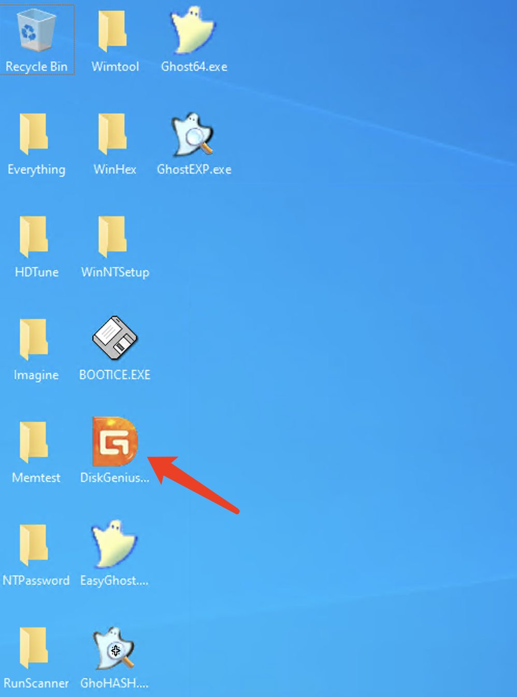
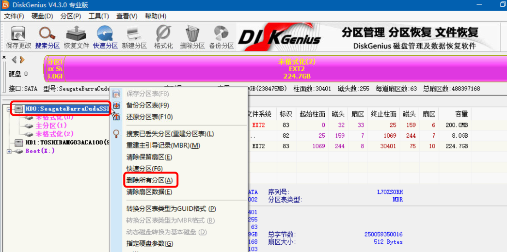

# Formatting a physical server hard drive

1.Formatting the hard drive by entering rescue mode.

Please refer to the method for entering rescue mode：[Rescue mode for Dedicated Server](/operations-knowledge-base/dedicated-server/how-to-use-rescue-mode-on-a-dedicated-server)

2.Click on the DiskGenius software.

3.Click on the hard drive, right-click, and select 'Delete Partition.' After deletion, click 'Save' in the upper right corner.

