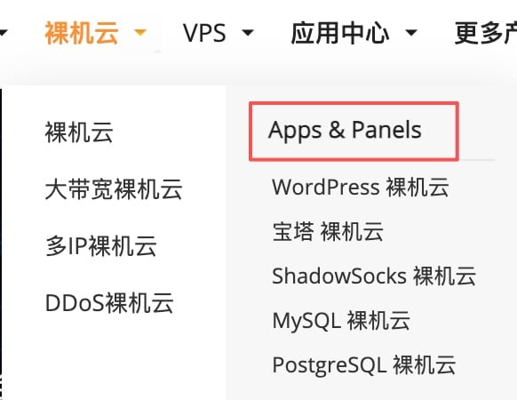
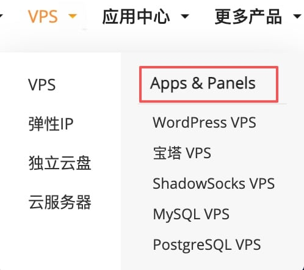
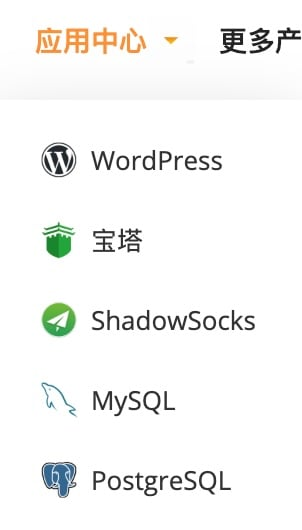
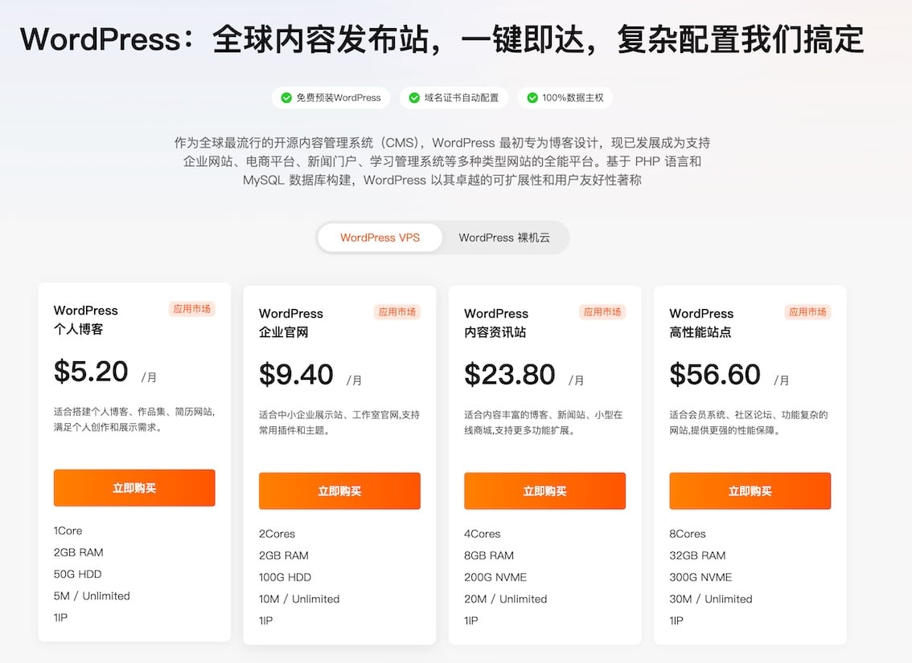
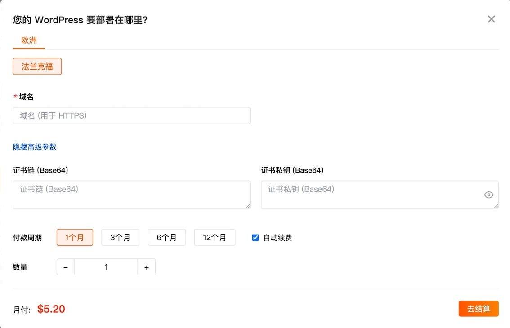
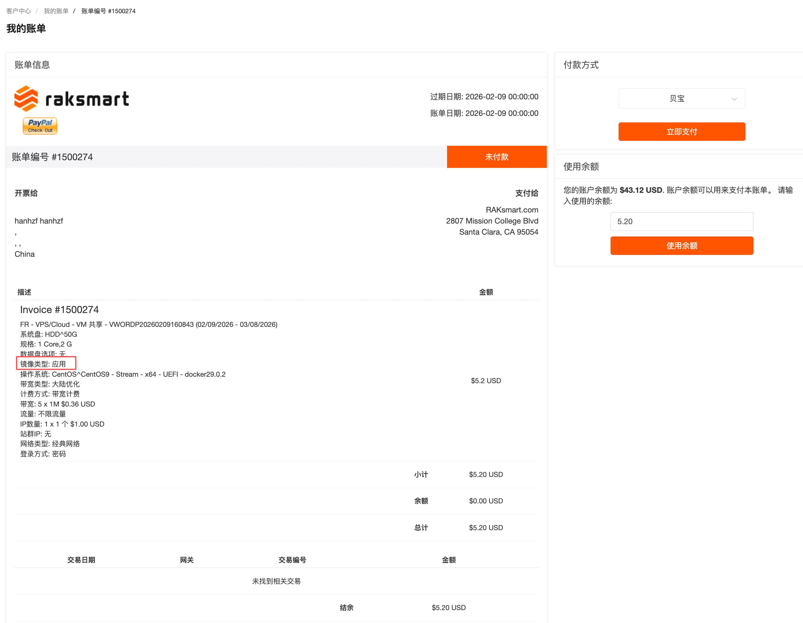
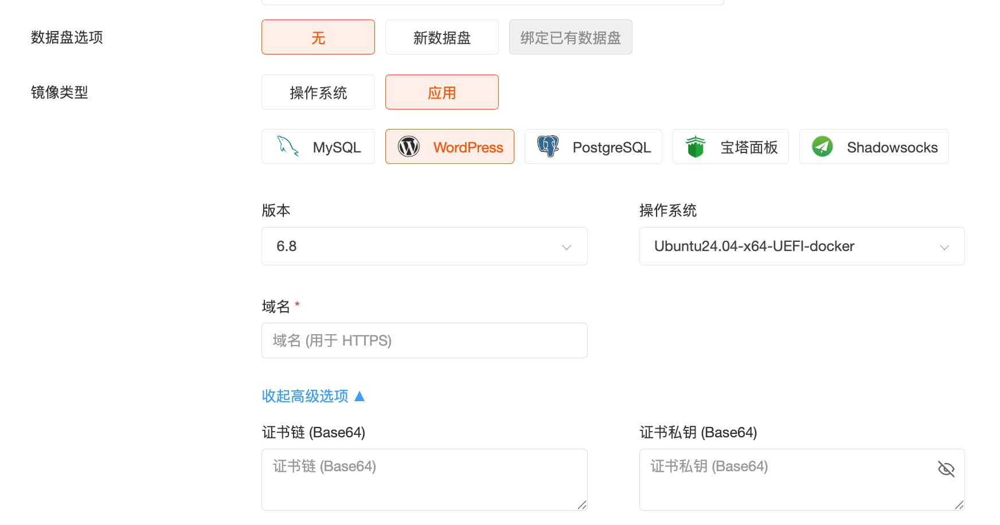
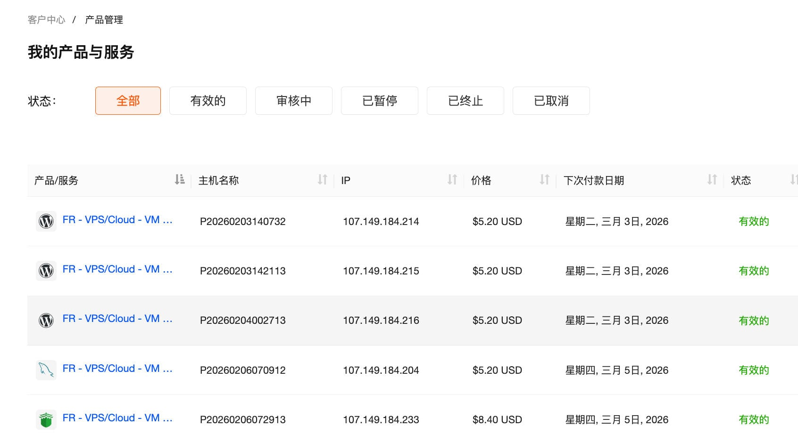
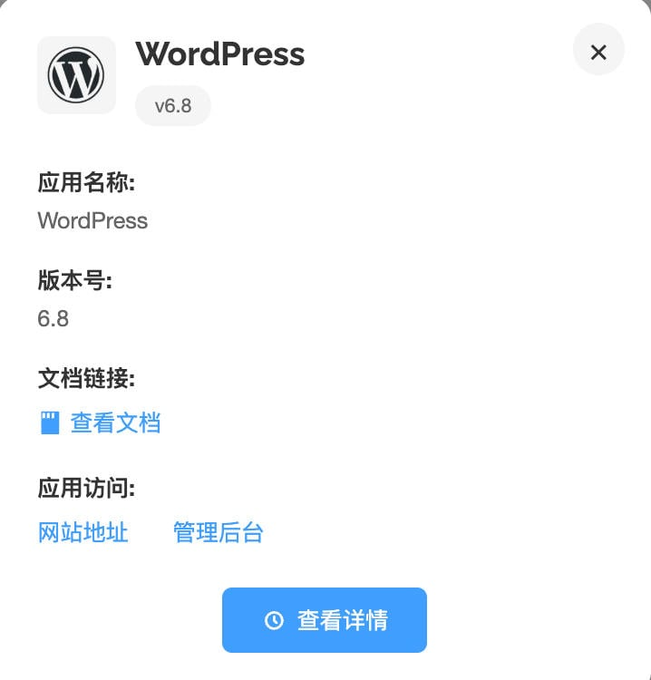
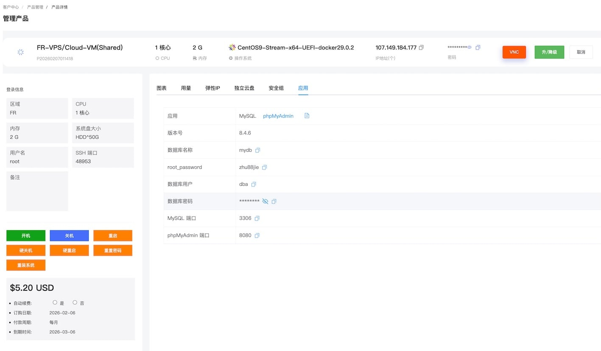

# 应用中心使用指南

## 产品概述

### RakSmart 应用中心是什么

RakSmart 应用中心是一个一键部署开源应用的云服务平台。我们精选了社区中成熟、可靠的开源软件，将复杂的安装配置过程封装成简单的部署流程，让您无需具备专业的运维知识，也能快速拥有自己的应用服务。

目前应用中心提供以下几类应用：

| 分类 | 应用 | 说明 |
| --- | --- | --- |
| AI 智能体 | OpenClaw、CoPaw | 可接入多种大模型的 AI 智能体应用 |
| 数据库 | MySQL、PostgreSQL | 主流关系型数据库 |
| 内容管理 | WordPress | 全球最流行的建站系统 |
| 服务器管理 | 宝塔面板 | 可视化的服务器管理工具 |

我们会持续关注社区中受欢迎的开源项目，不断丰富应用中心的选择。

### 计费模式

应用中心的应用本身不收取额外费用，您只需支付承载应用的云服务器费用，价格与购买普通云服务器完全相同。

### 适用场景

如果您有以下需求，应用中心可以帮您节省大量时间：

- **快速验证想法**：想试用某个开源应用，但不想花时间研究如何安装部署。
- **付费 SaaS 备选方案**：希望使用类似 SaaS 的服务，但更看重数据自主可控和长期成本。
- **零基础建站**：没有运维经验，但需要搭建自己的网站或服务。

典型应用场景：

- **内容发布**：使用 WordPress 搭建博客或企业官网时，您不需要了解域名解析、SSL 证书配置等技术细节，应用中心会自动完成这些配置，让您专注于内容创作。
- **数据库服务**：部署 MySQL 或 PostgreSQL 时，系统会自动完成安装配置，并附带可视化的管理面板（phpMyAdmin / pgAdmin），您可以通过网页界面管理数据库，无需记忆命令行操作。
- **服务器管理**：部署宝塔面板后，您可以通过网页界面管理服务器上的网站、数据库、文件等，无需掌握 Linux 命令行操作。

## 快速开始

### 应用市场入口位置

应用中心已在裸机云和 VPS 产品上线。您可以通过以下方式进入：

**方式一：从云产品菜单进入**

如果您已确定使用裸机云或 VPS，可以在网站顶部导航栏点击对应菜单，在下拉列表中找到“APPS”分类，选择需要的应用。





**方式二：从应用中心进入**

如果您想先浏览有哪些应用可选，可以点击导航栏的“应用中心”，查看全部应用列表。



### 应用选购流程

1. **选择应用和配置**

   进入应用落地页后，您可以看到应用的基本介绍。页面上提供了针对不同使用场景的配置套餐推荐，您也可以在 VPS 和裸机云之间切换选择。确定配置后，点击“立即购买”。

   

2. **填写部署信息**

   在弹出的购买窗口中，完成以下配置：

   - **部署区域**：选择服务器所在的地理位置（美洲、亚洲、欧洲）。
   - **主机名和主机密码**：设置服务器的登录凭据，部署完成后可通过 SSH 登录服务器进行管理。
   - **应用参数**：根据应用要求填写必要的配置参数（如数据库密码、域名等）。
   - **付款周期和数量**：选择购买时长和数量。

   填写完成后，点击“去结算”。

   

3. **确认订单并完成支付**

   在订单确认页核对信息，如有优惠券可在此使用，确认无误后完成支付。支付完成后进入账单页面，您可以在此查看本次购买的完整信息，包括服务器的详细配置参数。

   完成支付后，系统将自动开始部署应用，整个过程预计在 1-3 分钟内完成。

   

> **提示**
>
> 虚拟机启动后，应用需要约 1~3 分钟的初始化时间。请在部署完成后稍作等待，待应用完全加载后再进行访问，以确保获得最佳使用体验。

## 更多的部署选择

除了从应用落地页快速部署外，您也可以从 VPS 或裸机云的产品购买页面进入，选择应用镜像进行部署。

这种方式适合希望自定义更多服务器配置的用户。在价格计算器页面中，您可以详细配置 CPU、内存、硬盘、网络等参数。由于每款应用有最低配置要求，页面中展示的配置选项均已满足该应用的运行需求。

在“操作系统”选项中，将标签页切换到“应用市场”，即可看到所有可用的应用。选择应用后，您还可以进一步选择应用的版本以及对应的操作系统。



## 应用管理

### 查看已购应用

应用购买完成后，您可以在“客户中心 → 产品管理 → 我的产品与服务”页面查看，查看方式与原有的 VPS/裸机云产品相同。



在产品列表中，应用会在名称前显示对应的图标，方便您快速识别。将鼠标悬浮在产品名称上，可以看到应用的基本信息，包括应用名称、版本号及访问地址等。



### 应用详情页

点击产品名称进入详情页，页面布局与原有的 VPS/裸机云产品管理页面相同。

针对应用，我们在右侧管理面板中新增了“应用”标签页。点击该标签，您可以查看：

- 应用名称和版本号
- 访问地址等信息
- 应用的参数配置详情
- 应用文档链接（点击可查看完整的应用使用文档）



> **注意**
>
> 首次创建或者重装应用后，应用需要约 1~3 分钟完成加载。建议在操作后稍作等待再访问应用，避免因服务未就绪而导致访问失败。

### 访问凭证说明

所有应用涉及的访问信息（如数据库密码、管理员账号等）均存放于服务器的凭证文件中：

- 文件路径：`/opt/cloud/<应用名称>/credentials.txt`
- 示例：WordPress 应用的凭证文件为 `/opt/cloud/wordpress/credentials.txt`

您可以通过 SSH 登录服务器后查看该文件，获取完整的访问信息：

```bash
cat /opt/cloud/<应用名称>/credentials.txt
```

### 运维操作

应用本质上运行在 VPS 或裸机云服务器上，您可以像管理普通云服务器一样进行运维操作，如开机、关机、重启等。

如需了解应用相关的运维命令（如启动、停止、备份等），可以通过 SSH 登录服务器查看。登录后的欢迎信息中会显示该应用的常用管理命令，您也可以参考各应用的使用指南获取更多信息。

## 常见问题

### 部署遇到问题怎么办

如果应用部署过程中遇到问题，您可通过提交工单联系我们的技术支持团队，处理方式与其他产品相同。

### 技术支持渠道

如需帮助，您可以通过以下方式联系我们：

- **在线客服**：点击页面右下角的客服图标。
- **提交工单**：登录客户中心，进入“技术支持”提交工单。
